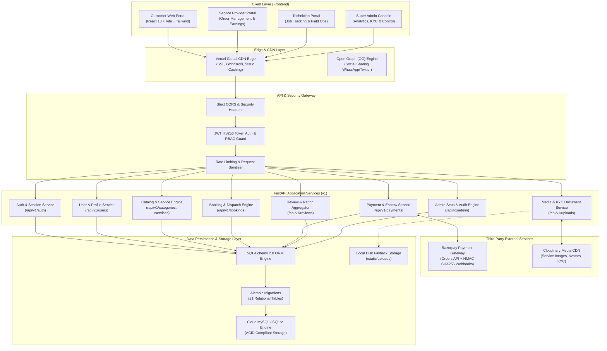

# 🏗️ HomeServe — System Architecture & Technical Design

> **On-Demand Home Services Booking SaaS Platform**  
> Scalable, Multi-Tenant, Role-Based Micro-Architecture built with **FastAPI**, **React 18**, and **Relational Database Management System (SQLite / Cloud MySQL)**.

---

## 1. High-Level System Architecture Diagram

---

## 2. Core Architectural Pillars

### A. Frontend Architecture (React 18 + Vite + Tailwind CSS)
- **Role-Based Routing**: Strict route guarding using `ProtectedRoute` enforcing granular role permissions (`customer`, `provider`, `technician`, `super_admin`).
- **State Management**: Reactive `AuthContext` maintaining token lifecycle, user session synchronization, and automatic logout upon expiry.
- **Micro-Interactions**: Lucide icons, responsive modal dialogs, real-time dynamic toast notifications, and animated service badges.
- **Payment Modal**: Seamless integration with the official Razorpay Checkout SDK via client-side injection with prefill user profiles.

### B. Backend Architecture (FastAPI v1)
- **Asynchronous Execution**: High-throughput asynchronous routing powered by Starlette and Uvicorn.
- **Dependency Injection**: Declarative `Depends(get_db)`, `Depends(get_current_user)`, and `Depends(require_role(...))` enforcing separation of concerns.
- **Pydantic v2 Serialization**: Comprehensive bidirectional data contracts preventing input poisoning, SQL injection, and invalid payloads.
- **HMAC Signature Cryptography**: Bank-grade webhook verification for Razorpay payment captures with timing-safe comparison.

### C. Enterprise Data Architecture
- **21 Normalized Relational Entities**: Covering the end-to-end service lifecycle from customer booking, multi-item line tasks, payment ledger, technician slot dispatch, provider payouts, support tickets, to system audit logs.
- **Alembic Database Versioning**: Declarative migration scripts enabling zero-downtime upgrades and multi-cloud DB portability (SQLite ↔ Cloud MySQL).

---

## 3. Security & Compliance Matrix

| Security Layer | Implementation Details |
|---|---|
| **Authentication** | JSON Web Tokens (JWT) signed with HS256, strictly sourced `SECRET_KEY`, 24h expiration |
| **Password Hashing** | Passlib Bcrypt with automated length sanitation (prevents bcrypt 72-byte buffer errors) |
| **CORS Policy** | Explicit domain whitelist (No wildcard `*` with credentials), rejecting unauthorized cross-origin pre-flights |
| **Authorization (RBAC)** | 4-tier hierarchy: Super Admin > Provider > Technician > Customer |
| **Payment Integrity** | HMAC-SHA256 signature verification comparing `order_id` + `payment_id` against merchant secret |
| **Audit Trail** | Dedicated `audit_logs` table tracking sensitive system events, actor user ID, action, and IP address |

