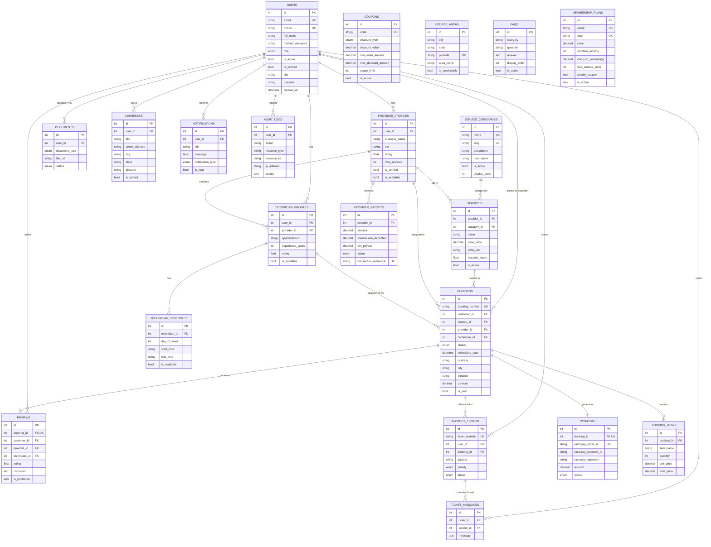

# 🗄️ HomeServe — Entity Relationship Diagram (ERD)

> **Complete 21-Table Relational Schema Architecture**  
> Managed with **SQLAlchemy 2.0** and version-controlled via **Alembic Migrations**.

---

## 1. Mermaid Entity-Relationship Diagram

---

## 2. Relational Schema Data Dictionary

| # | Entity / Table Name | Primary Role & Description | Foreign Keys / Dependencies |
|---|---|---|---|
| 1 | `users` | Unified authentication & identity repository for all 4 roles | Self-contained |
| 2 | `service_categories` | Hierarchical taxonomy of home maintenance offerings | Self-contained |
| 3 | `services` | Specific bookable catalog services with baseline rates | `provider_id`, `category_id` |
| 4 | `provider_profiles` | Extended commercial & compliance profile for agencies | `user_id` |
| 5 | `technician_profiles` | Field operative skill set, certifications, and agency link | `user_id`, `provider_id` |
| 6 | `bookings` | Core transaction entity recording order lifecycle & schedule | `customer_id`, `service_id`, `provider_id`, `technician_id` |
| 7 | `payments` | Cryptographically signed Razorpay transactions & escrow ledger | `booking_id` |
| 8 | `reviews` | Customer feedback, 5-star ratings, and provider reputation score | `booking_id`, `customer_id`, `provider_id`, `technician_id` |
| 9 | `documents` | Identity verification, police clearance, and trade license records | `user_id` |
| 10 | `coupons` | Promotional vouchers with percentage/flat discount rules & caps | Self-contained |
| 11 | `booking_items` | Granular line items, spare parts, and add-on services | `booking_id` |
| 12 | `notifications` | In-app alerts, order updates, and promotional broadcasts | `user_id` |
| 13 | `audit_logs` | Immutable audit trail for security, authentication, and admin events | `user_id` |
| 14 | `addresses` | Customer saved address book with landmarks and geo-coordinates | `user_id` |
| 15 | `service_areas` | Operational coverage zones, city boundaries, and active pincodes | Self-contained |
| 16 | `technician_schedules` | Weekly shift availability and working hours per technician | `technician_id` |
| 17 | `provider_payouts` | Net revenue settlement, agency payouts, and commission accounting | `provider_id` |
| 18 | `support_tickets` | Customer service issue management and resolution tracker | `user_id`, `booking_id` |
| 19 | `ticket_messages` | Threaded conversation messages between customer and helpdesk | `ticket_id`, `sender_id` |
| 20 | `faqs` | Frequently Asked Questions and self-serve knowledge base | Self-contained |
| 21 | `membership_plans` | SaaS recurring subscription membership tiers (HomeServe VIP) | Self-contained |

